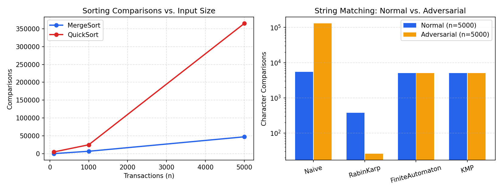

# Project 07: Banking Transaction Fraud Investigation Workbench (`BankTransFraud_C17`)

## 1. Architecture & Data Flow

```text
+-----------------------+      +---------------------------+      +-------------------------+
|  data_generator.c     | ---> |  transaction.c            | ---> |  fraud_rules.c          |
|  (Synthetic CSV gen)  |      |  (CSV -> TransactionList) |      |  (Risk & Account Score) |
+-----------------------+      +-------------+-------------+      +-------------------------+
                                             |
         +-----------------------------------+-----------------------------------+
         v                                   v                                   v
+--------------------+         +---------------------------+         +-----------------------+
| graph.c            |         | sorting.c / searching.c   |         | divide_conquer.c      |
| (Directed DFS)     |         | string_matching.c         |         | greedy.c / dp.c       |
+--------------------+         +---------------------------+         | backtracking.c        |
                                                                     | flow.c / number_theory|
                                                                     +-----------+-----------+
                                                                                 |
                                                                                 v
                               +---------------------------+         +-----------------------+
                               | main.c (CLI Options 1-11) | <-----> | benchmark.c           |
                               | + 3 Demo Scenarios        |         | -> benchmark_results  |
                               +---------------------------+         +-----------------------+
```

---

## 2. Operational Domain Mapping (All 9 Syllabus Families)

| Syllabus Area | Algorithms | Operational Fraud-Workbench Role | Source File |
| :--- | :--- | :--- | :--- |
| **Sorting & Searching** | Merge Sort, Quick Sort, Binary Search (Iter/Rec) | Ranks transactions by `amount` or `transactionId` and performs $O(\log n)$ audit lookups | `sorting.c`, `searching.c` |
| **String Matching** | Naive, Rabin-Karp, Finite Automaton, KMP | Scans transaction `description` streams for laundering keywords (`urgent`, `mule`, `siphon`, `transfer`) | `string_matching.c` |
| **Divide & Conquer** | Max Subarray (D&C + Kadane), ModPow, Celebrity, Classical vs. Strassen | Detects peak suspicious activity windows, hashes account IDs, spots mule-hub sinks, and computes `twoHopConnections` ($A \times A$) | `divide_conquer.c`, `divide_conquer_matrix.c` |
| **Greedy Methods** | Activity Selection, Interval Partitioning, Fractional Knapsack, Huffman, Dijkstra, Kruskal & Prim | Schedules non-overlapping case reviews, allocates splittable analyst hours, compresses audit logs, finds `cheapestFundFlowPath`, and builds minimal `investigationNetwork` | `greedy.c` |
| **Dynamic Programming** | 0/1 Knapsack, Matrix-Chain, LCS, Optimal BST, Bellman-Ford, Floyd-Warshall, Bounded TSP | Exact non-splittable case triage (`knapsack01DP`), optimal parenthesization of multi-hop adjacency matrix chains (`matrixChainOrder`), behavioral pattern similarity across merchant/wire sequences (`longestCommonSubsequence`), keyword-dictionary lookup optimization (`optimalBST`), negative-weight risk-adjusted paths (`bellmanFord`, `floydWarshall`), and optimal audit tour (`tspHeldKarp`) | `dp.c` |
| **Backtracking & Branch and Bound** | N-Queens, Sum of Subsets, 0/1 Knapsack (BT, FIFO, LIFO, Least-Cost B&B) | Constraint-solver validation (`solveNQueens`), detecting smurfed deposits summing to a target laundering total (`sumOfSubsets`), and exact case triage comparing pruning efficiency | `backtracking.c` |
| **Flow & Matching** | Ford-Fulkerson (Edmonds-Karp), Maximum Bipartite Matching | Measures maximum illicit transfer throughput between source/sink accounts and assigns flagged cases to eligible investigators | `flow.c` |
| **Number Theory** | Extended GCD, Modular Inverse, Chinese Remainder Theorem | Reconstructs global transaction totals from distributed branch modular checksums (`reconstructDistributedTxTotal`) to detect ledger tampering | `number_theory.c` |

---

## 3. Correctness Proofs, Invariants & Edge Cases

- **Binary Search (`searching.c`):**
  - *Precondition:* `transactions` is sorted in ascending order by `transactionId` (`count >= 0`).
  - *Loop Invariant:* If `targetId` exists in `transactions[0..count-1]`, it lies in `transactions[leftIndex..rightIndex]`.
  - *Termination & Postcondition:* Each iteration strictly halves `rightIndex - leftIndex + 1`; returns an index `m` with `transactions[m].transactionId == targetId`, or `-1` if absent.
- **Merge Sort (`sorting.c`):**
  - *Invariant:* `mergeRange` maintains `temp[0..k-1]` sorted in non-decreasing order from the two sorted halves `transactions[left..mid]` and `transactions[mid+1..right]`, preserving stability (`<=`).
- **Kruskal's MST (`greedy.c`):**
  - *Cut Property Invariant:* Sorting edges by non-decreasing weight and uniting only distinct `UnionFind` components guarantees every added edge is a minimum-weight edge crossing a cut between components. Disconnected graphs cleanly yield a minimum spanning forest with `componentCount > 1`.
- **Branch & Bound Upper-Bound Validity (`backtracking.c`):**
  - `fractionalUpperBound` relaxes the 0/1 integrality constraint to allow taking a fraction of the next highest `riskScore / hoursRequired` item. Because any valid 0/1 completion is also a valid fractional completion, `bound >= trueIntegerOptimum`. Thus, pruning any node with `bound <= currentBestRisk` never discards an optimal integer solution.
- **Malformed / Extreme Inputs:**
  - `loadTransactionsFromCSV` skips malformed rows with fewer than 6 columns and returns an empty `TransactionList` on missing files without crashing.
  - `chineseRemainderTheorem` checks `(r2 - curRem) % gcd(curMod, m2) == 0` at every step, setting `valid = 0` on inconsistent congruences.

---

## 4. Recurrence Relations & Asymptotic Analysis

| Module | Recurrence | Solution | Method |
| :--- | :--- | :--- | :--- |
| **Binary Search** | $T(n) = T(n/2) + \Theta(1)$ | $\Theta(\log n)$ | Master Theorem Case 2 ($a=1, b=2, f(n)=\Theta(1)$) |
| **Merge Sort** | $T(n) = 2T(n/2) + \Theta(n)$ | $\Theta(n \log n)$ | Master Theorem Case 2 ($a=2, b=2, f(n)=\Theta(n)$) |
| **Quick Sort (Worst)** | $T(n) = T(n-1) + \Theta(n)$ | $\Theta(n^2)$ | Recursion tree ($\sum_{k=1}^n k$); Master Theorem **not applicable** |
| **Max Subarray (D&C)** | $T(n) = 2T(n/2) + \Theta(n)$ | $\Theta(n \log n)$ | Master Theorem Case 2 (vs. Kadane $\Theta(n)$) |
| **Strassen Multiply** | $T(n) = 7T(n/2) + \Theta(n^2)$ | $\Theta(n^{\log_2 7}) \approx \Theta(n^{2.807})$ | Master Theorem Case 1 (`STRASSEN_CUTOFF = 16`) |

---

## 5. Benchmark Methodology & Empirical Results

- **Environment:** `Linux 6.12.105+ x86_64`, `gcc (Debian 12.2.0-14+deb12u1) 12.2.0`, flags `-std=c17 -Wall -Wextra` (unoptimized `-O0` default build for deterministic operation counting).
- **Timing & Memory Measurement:** Timings use ISO C17 `timespec_get(&ts, TIME_UTC)` (microsecond resolution; Binary Search is repeated `200x` per tier to exceed timer noise). Recorded `peakExtraBytes` reflects **algorithmic auxiliary allocation estimates** via `trackBytes()` rather than OS resident set size (RSS). Single-run timings on small inputs ($n \le 100$) exhibit OS scheduling variance, so algorithmic comparisons rely primarily on deterministic operation counts (`comparisons`, `swapsOrAssignments`, `recursiveCalls`).
- **Empirical Scaling Chart:**



- **Key Findings:**
  - `QuickSort` performs substantially more comparisons than `MergeSort` on reverse-sorted adversarial data (`499,500` vs. `4,932` at $n=1{,}000$).
  - `KMP` and `FiniteAutomaton` remain linear on adversarial `"aaaa...b"` text while `Naive` degrades quadratically.
  - `Least-Cost B&B` explores fewer nodes (`10`) than `FIFO` (`11`), `LIFO` (`12`), and `Backtracking` (`16`) for the same optimal risk `195.0`.

---

## 6. Verification & Sanitizer Evidence

- **`make test`** (`tests/test_all.c`): Passes all small-instance oracles, unit tests, end-to-end integration tests, randomized property checks (10 random trials verifying sortedness and search consistency), malformed CSV parsing, duplicate-edge/disconnected MST, negative-cycle detection, and $n=10{,}000$ stress tests (`ALL_C17_PROJECT07_TESTS_PASSED`).
- **`make sanitize`** (`-fsanitize=address,undefined -g -O1`): Passes the entire `tests/test_all.c` suite with zero memory leaks, out-of-bounds accesses, or undefined behavior.

---

## 7. P / NP Classification, Reduction & Ethics

- **In P:** Sorting, Binary Search, String Matching, MST, Dijkstra, Bellman-Ford, Floyd-Warshall, Max Flow, Bipartite Matching, Extended GCD/CRT.
- **NP-Complete / NP-Hard:** Subset Sum and 0/1 Knapsack (decision) are **NP-complete**; 0/1 Knapsack (optimization) and TSP are **NP-hard**.
- **Polynomial-Time Reduction ($\text{Subset Sum} \le_p \text{0/1 Knapsack}$):** Map Subset Sum $(S=\{s_1,\dots,s_n\}, T)$ in $O(n)$ time to 0/1 Knapsack with `hoursRequired` $= s_i$, `riskScore` $= s_i$, capacity $W=T$, and target risk $K=T$. A subset sums to $T$ iff the knapsack achieves risk $\ge T$ within capacity $T$.
- **Limitations & Ethics:** Heuristic flags (location/keywords) can introduce geographic or demographic bias; outputs (`reasons[]`) must serve as explainable triage aids for human analysts rather than automated account freezes.
